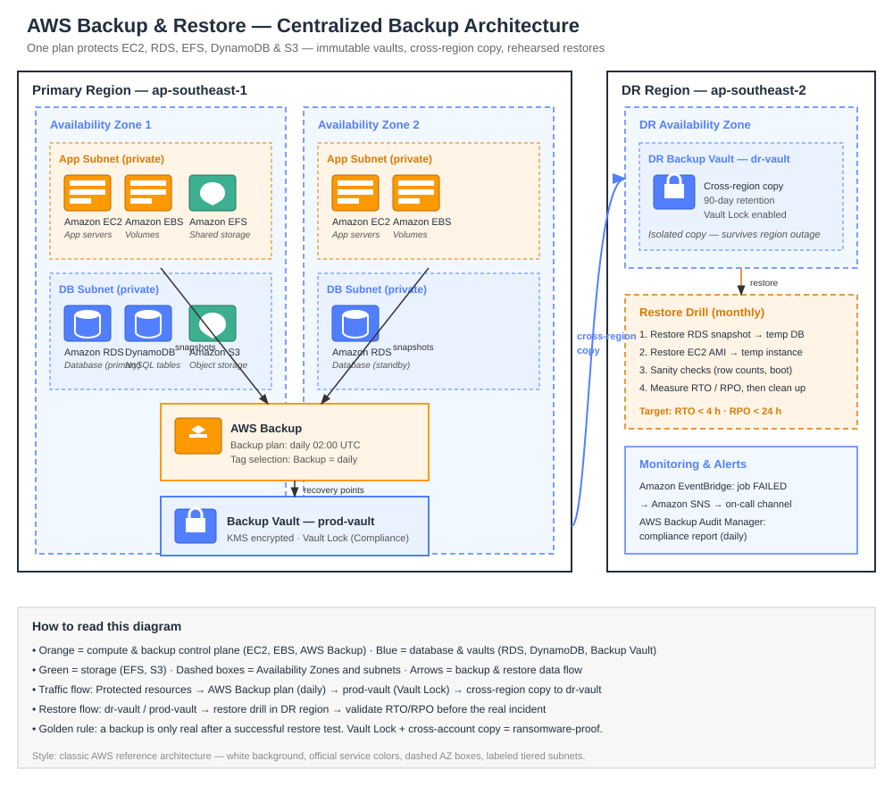

# AWS Backup & Restore Guide


> **Backups nobody tests are just hope with extra steps.** This guide shows how to build a centralized, tamper-proof backup strategy with AWS Backup — one plan, every resource, cross-region copies, and restores you actually rehearse.

## TL;DR

- **AWS Backup** is the single control plane for EC2, EBS, RDS, Aurora, DynamoDB, EFS, FSx, and S3 backups.
- A **backup plan** = schedule + retention + lifecycle (cold storage) + copy rules, applied to resources by **tag or resource selection**.
- **Backup Vault Lock** (WORM) makes recovery points immutable — even the root account cannot delete them before expiry. This is your ransomware last line of defence.
- **Cross-region copy** protects against a full region outage; **cross-account copy** protects against a compromised account.
- A backup you never restored is a backup you don't have. **Schedule restore tests** and measure RTO/RPO for real.

## Architecture



**Flow:** Protected resources (EC2, RDS, EFS, DynamoDB, S3) → AWS Backup plan (daily snapshot, weekly full) → Backup Vault (encrypted with KMS, Vault Lock in Compliance mode) → Cross-region copy to the DR region vault → Restore drills validate RTO/RPO.

## Backup Plan Design

| Resource | Frequency | Retention | Lifecycle | Copy |
|---|---|---|---|---|
| RDS / Aurora | Daily + continuous PITR | 35 days | — | DR region, 90 days |
| EC2 / EBS | Daily snapshot | 30 days | Cold after 7 days | DR region, 60 days |
| DynamoDB | Daily (PITR on) | 30 days | — | DR region |
| EFS | Daily | 30 days | Cold after 30 days | DR region |
| S3 | Daily (versioning on) | 90 days | Glacier after 30 days | DR region |

### RPO / RTO targets

| Scenario | RPO | RTO | Mechanism |
|---|---|---|---|
| Accidental delete (single table / file) | < 1 h | < 30 min | Point-in-time / item-level restore |
| AZ failure | 0 (Multi-AZ) | Minutes | Automatic failover, no restore needed |
| Region outage | 24 h | 2–4 h | Cross-region copy → restore in DR region |
| Ransomware / account compromise | 24 h | 4–8 h | Vault Lock copy in isolated account |

## Quick Start

```bash
# 1. Deploy the backup plan + vaults
terraform init && terraform apply

# 2. Tag resources to opt them in
aws ec2 create-tags --resources i-0123456789abcdef0 \
  --tags Key=Backup,Value=daily Key=Environment,Value=prod

# 3. Trigger an on-demand backup job
aws backup start-backup-job \
  --backup-vault-name prod-vault \
  --resource-arn arn:aws:rds:ap-southeast-1:123456789012:db:orders \
  --iam-role-arn arn:aws:iam::123456789012:role/service-role/AWSBackupDefaultServiceRole

# 4. List recovery points and check the last successful job
aws backup list-recovery-points-by-backup-vault --backup-vault-name prod-vault
```

## Terraform Snippet

```hcl
resource "aws_backup_plan" "prod" {
  name = "prod-daily-plan"

  rule {
    rule_name         = "daily"
    target_vault_name = aws_backup_vault.prod.name
    schedule          = "cron(0 2 * * ? *)" # 02:00 UTC daily

    lifecycle {
      cold_storage_after = 7
      delete_after       = 30
    }

    copy_action {
      destination_vault_arn = aws_backup_vault.dr.arn
      lifecycle { delete_after = 90 }
    }
  }
}

resource "aws_backup_vault_lock_configuration" "prod" {
  backup_vault_name   = aws_backup_vault.prod.name
  min_retention_days  = 7
  max_retention_days  = 365
  changeable_for_days = 3 # grace period before Compliance mode locks
}
```

See [`main.tf`](./main.tf) for the full working example: vaults in two regions, KMS encryption, tag-based selection, and a restore-test Lambda.

## Restore Testing — The Part Everyone Skips

1. **Monthly:** restore an RDS snapshot to a throwaway instance, run `SELECT count(*)` sanity checks, delete it.
2. **Quarterly:** full DR drill — restore EC2 AMIs + EFS + DynamoDB in the DR region and boot the app.
3. **After every plan change:** verify the next scheduled job actually succeeded (`COMPLETED`, not `FAILED` or `EXPIRED`).
4. **Alert on failure:** an EventBridge rule → SNS → your on-call channel. A failed backup job should page someone, not sit in a console.

```bash
# Restore an EBS volume from a recovery point (dry-run the flow!)
aws backup start-restore-job \
  --recovery-point-arn <recovery-point-arn> \
  --iam-role-arn arn:aws:iam::123456789012:role/service-role/AWSBackupDefaultServiceRole \
  --metadata file://restore-metadata.json
```

## Common Mistakes

| Mistake | Why it hurts | Fix |
|---|---|---|
| Backups in the same account & region only | Ransomware / account compromise wipes them too | Cross-account + cross-region copy |
| No Vault Lock | An attacker with your keys deletes the backups first | Compliance-mode Vault Lock, min 7 days |
| Never testing restores | You discover the backup is corrupt during the incident | Monthly restore drills, automated |
| Tag-based selection with no tag governance | New resources silently unprotected | SCP / Config rule: `Backup` tag required |
| Infinite retention | Storage bill grows forever | Lifecycle to cold storage, then delete |

## Cost Levers

- **Cold storage tier** (~75% cheaper than warm) for anything older than 7–30 days.
- **Incremental EBS snapshots** — only changed blocks are stored.
- **Delete test/dev backups aggressively** — 7-day retention is plenty.
- **S3 backup** bills per version; pair it with S3 Lifecycle, not just Backup retention.

## 🧠 Quiz Teaser

> **Q:** An attacker gains admin access to your AWS account and deletes all EBS snapshots. Which AWS Backup feature would have saved you?
>
> **A:** Cross-account backup copy + Vault Lock in Compliance mode — the attacker can't touch copies in the isolated account. Full quiz in [`quiz.md`](./quiz.md).

## Further Reading

- [AWS Backup Developer Guide](https://docs.aws.amazon.com/aws-backup/latest/devguide/whatisbackup.html)
- [AWS Backup Vault Lock](https://docs.aws.amazon.com/aws-backup/latest/devguide/vault-lock.html)
- [AWS Well-Architected — Reliability Pillar](https://docs.aws.amazon.com/wellarchitected/latest/reliability-pillar/welcome.html)

---

*Built as part of a daily cloud engineering series — one topic, one repo, every day.*
